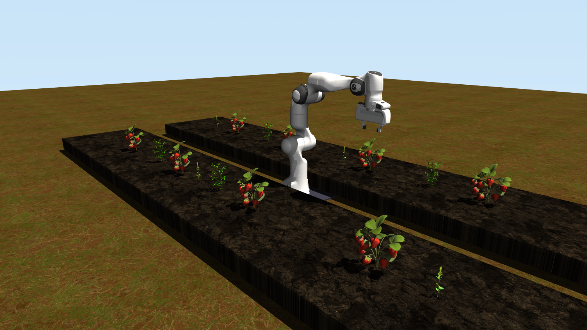

# VLA-Weed-Extraction

A MuJoCo simulation of a weeding robot: a Franka Panda arm on a rail drives along two
raised beds planted with strawberries and weeds.

It exists so the weeding behaviour can be developed without a field. The weeds are
modelled properly — stalks that bend and spring back, roots that tear only under a firm
upward pull — so anything that works here had to solve the real problem rather than a
toy version of it.



## Contents

- [Requirements](#requirements)
- [Run it natively](#run-it-natively)
- [Run it in Docker](#run-it-in-docker)
- [Pull a weed out](#pull-a-weed-out)
- [Watch the robot do it](#watch-the-robot-do-it)
- [Current status](#current-status)
- [Configuration](#configuration)
- [Tests](#tests)
- [API](#api)

## Requirements

Pick one path. You do not need both.

**Natively** — macOS, Linux or Windows (WSL):

- [git](https://git-scm.com/downloads)
- [Python 3.12 or newer](https://www.python.org/downloads/) — Ubuntu:
  `sudo apt install git python3.12 python3.12-venv`, macOS: `brew install git python@3.12`

Everything else installs into a virtualenv inside the repo. Nothing touches your system
Python.

**In Docker** — Linux:

- [Docker Engine](https://docs.docker.com/engine/install/ubuntu/) (on macOS or Windows,
  [Docker Desktop](https://docs.docker.com/get-started/get-docker/) — but the viewer
  needs an X display, so run natively there instead)

## Run it natively

Fastest way to see it. Works on macOS, Linux and Windows (WSL).

### First-time setup

Check your Python is new enough, then clone and install:

```
python3 --version    # 3.12 or newer
```

```
git clone --recurse-submodules https://github.com/DivyaRanjith06/VLA-Weed-Extraction.git
cd VLA-Weed-Extraction
python3.12 -m venv .venv
.venv/bin/pip install -e "workspace/planning/weed_extraction[dev]"
```

That pulls MuJoCo, Gymnasium, NumPy, OpenCV and draccus at pinned versions. Nothing is
installed outside `.venv`.

Cloned without `--recurse-submodules`? The Panda meshes are missing and nothing will
load. Fix it with:

```
git submodule update --init workspace/hardware/mujoco_menagerie
```

### Every time after that

```
./run_scripts/simulate.sh
```

## Run it in Docker

For Linux. Use this if you would rather not install Python 3.12, or you want the ROS 2
tools that are already in the image.

### First-time setup

```
git clone --recurse-submodules https://github.com/DivyaRanjith06/VLA-Weed-Extraction.git
cd VLA-Weed-Extraction/docker_scripts/run_scripts
./build.sh
```

Once, and the build takes a while. The image carries its own copy of the workspace, so
nothing else has to be installed.

### Every time after that

```
cd docker_scripts/run_scripts
./up.sh             # start the container and launch in one go
./stop.sh           # when you are done
```

The MuJoCo window opens on your desktop, exactly as it does natively.

To work inside the container instead:

```
./devel.sh          # start it, with the repo mounted
./enter_bash.sh     # get a shell
./run_scripts/simulate.sh
```

`devel.sh` mounts the repo over the copy baked into the image, so your edits take
effect with no rebuild. `base.sh` starts it without the mount, running the image's own
copy.

On a server with no display, everything still renders offscreen:
`MUJOCO_GL=egl weed-launch capture`

## Pull a weed out

Once the window is open:

- Scroll to zoom in on one of the green plants with no berries.
- Double-click it to select.
- Hold **Ctrl** and **right-drag upward**, about 3 cm.
- It stretches, tears loose and drops onto the soil. The terminal prints the force.

Drag sideways instead and it only bends — the root gives way to an upward pull, the way
a real one does. Press **F1** for the viewer's other controls.

## Watch the robot do it

```
./run_scripts/test_up_root.sh
```

The arm drives to a weed, comes in on the stalk from the side rather than straight down
its axis, closes on it 16 mm above the soil, gives it a short turn about the vertical and
lifts. The terminal names each phase and prints the pull and the twist the root felt when
it gave way.

Roots fail on twist as well as pull, so the two are combined: 15 N of straight pull will
do it, so will 0.07 N·m of twist on its own, and any mix in between. That is why twisting
works — it buys you the pull the arm would otherwise have to apply.

Pick a different weed with `--weed`, for example
`./run_scripts/test_up_root.sh --weed=sowthistle_2`. The next section says what to expect
from each species.

## Current status

The default weed, `shepherd_1`, comes out the way it is meant to: the root gives way during
the lift, on pull and twist together.

All four sowthistles now reach the grip without being knocked over, register as held, and
are carried out of the bed. Their roots break too early, though. The twist alone breaks
them, at about 0.4–0.5 N of pull, so the lift carries a plant that is already loose. Treat
sowthistle extraction as work in progress, not as a realistic pull-and-twist extraction.

Two things make the sowthistle grasp work:

- **The hand and wrist camera pass through sowthistle leaves.** Real leaves are thin and
  get brushed aside; here they are rigid, and the wide sowthistle canopy otherwise gets
  shoved over before the fingers arrive.
- **The grasp has a 1 mm tolerance.** A grasp counts when both fingertips touch the stem,
  or when one fingertip is on the stem and the other is within 1 mm of it. The two
  fingers move together, so if the arm stops a fraction of a millimetre off-centre, the
  first finger to touch stops both. Only contact with the target plant's own stem counts,
  and only once the gripper has been told to close.

The test suite passes: 36 tests.

## Configuration

`simulate.sh` passes everything through to the launcher.

- `./run_scripts/simulate.sh` — the viewer (default)
- `./run_scripts/simulate.sh capture` — save one frame per camera into `outputs/`
- `./run_scripts/simulate.sh capture --supersample=4` — slower, but the cleanest edges
- `./run_scripts/simulate.sh view --base_x=1.5` — start with the arm 1.5 m along the bed

Presets live in `workspace/planning/weed_extraction/configs/`. Any field in one can be
overridden with `--name=value`.

Three cameras: `rgb_camera` follows the robot from a distance, `d435i_color` and
`d435i_depth` are the RealSense D435i on the wrist.

## Tests

```
cd workspace/planning/weed_extraction
../../../.venv/bin/python -m pytest
```

Thirty-six checks covering the scene, the gripper's grip on a stem, the root breaking at
the right force and only in the right direction, the stalk bending and springing back,
the crop staying put, the IK keeping the arm out of the beds, the whole
grasp-twist-pull sequence end to end on the shepherd's purse, and the sowthistle reaching
the grip and staying held.

If you have ROS sourced and pytest fails before running anything with
`No module named 'lark'`, run it as
`env -u PYTHONPATH PYTEST_DISABLE_PLUGIN_AUTOLOAD=1 ../../../.venv/bin/python -m pytest`.

## API

The simulation is a Gymnasium environment:

```python
import gymnasium as gym
import weed_extraction  # registers the env

env = gym.make("WeedExtraction-v0", cameras=["d435i_color"])
obs, _ = env.reset()
obs, reward, terminated, truncated, info = env.step(env.action_space.sample())
print(info["uprooted"])   # names of any weeds torn loose this step
```

Actions are the nine actuator targets: seven arm joints, the gripper (0 closed to 255
open) and the base position in metres. Observations are joint positions, velocities and
one image per camera. Reward is 0 — no task is defined yet.
